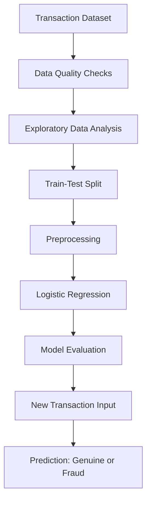

<div align="center">

# 💳 Credit Card Fraud Detection

### Machine Learning Mini-Project | Logistic Regression


**An end-to-end machine learning project that classifies credit card transactions as genuine or potentially fraudulent.**

</div>

---

## 📌 Table of Contents

- [About the Project](#-about-the-project)
- [Objectives](#-objectives)
- [How It Works](#-how-it-works)
- [Technologies Used](#-technologies-used)
- [Dataset](#-dataset)
- [Exploratory Data Analysis](#-exploratory-data-analysis)
- [Model and Results](#-model-and-results)
- [Project Structure](#-project-structure)
- [Installation](#-installation)
- [How to Run](#-how-to-run)
- [Reports](#-reports)
- [Limitations](#-limitations)
- [Future Improvements](#-future-improvements)
- [Author](#-author)

## 📖 About the Project

Credit card fraud detection is a binary classification problem. This project uses a **Logistic Regression** machine learning model to predict whether a transaction is:

- **Genuine (0)** — the transaction is classified as non-fraudulent.
- **Fraud (1)** — the transaction is classified as potentially fraudulent.

The project includes data quality checks, exploratory data analysis (EDA), preprocessing, model training, evaluation, cross-validation, and predictions for newly entered transactions.

> **Academic project note:** The supplied dataset contains 1,000 records and is described in the project report as synthetic transaction data. Results on this dataset should not be interpreted as real-world banking performance.

## 🎯 Objectives

- Explore transaction data and understand its patterns.
- Check the dataset for missing values and duplicate records.
- Visualize transaction amounts, categories, class distribution, and numerical correlations.
- Prepare numerical and categorical features for machine learning.
- Train a Logistic Regression classifier.
- Evaluate predictions with accuracy, precision, recall, F1-score, and a confusion matrix.
- Test model stability using stratified 5-fold cross-validation.
- Predict whether newly entered transactions are genuine or potentially fraudulent.

## ⚙️ How It Works



### Preprocessing

- **Numerical features:** Standardized using `StandardScaler`.
- **Categorical features:** Encoded using `OneHotEncoder`.
- **Combined preprocessing:** Managed through `ColumnTransformer` and a Scikit-learn `Pipeline`.
- **Data split:** 80% training data and 20% testing data, using stratification.

## 🧰 Technologies Used

| Technology | Purpose |
|---|---|
| Python | Main programming language |
| Pandas | Data loading and manipulation |
| NumPy | Numerical operations |
| Matplotlib | Data visualization |
| Seaborn | Statistical charts and heatmaps |
| Scikit-learn | Preprocessing, model training, and evaluation |
| SciPy | Statistical utilities |
| Sweetviz | Automated EDA report |
| Joblib | Saving the trained model |

## 📊 Dataset

**File:** `Dataset/filtered_1000_records.csv`

| Dataset detail | Information |
|---|---:|
| Total records | 1,000 |
| Total columns | 13 |
| Genuine transactions (`is_fraud = 0`) | 500 |
| Fraud transactions (`is_fraud = 1`) | 500 |
| Target column | `is_fraud` |

The dataset includes transaction and location-related fields such as card number identifier, merchant, category, amount, city, state, ZIP code, customer coordinates, merchant coordinates, and distance.

The model code selects these input features:

- **Categorical:** `merchant`, `category`, `city`, `state`
- **Numerical:** `cc_num`, `amt`, `zip`, `lat`, `long`, `merch_lat`, `merch_long`

The target variable is `is_fraud`. The `distance_km` column is present in the CSV but is not selected by the current model code.

## 🔎 Exploratory Data Analysis

The project code generates the following visualizations:

- Transaction amount histogram
- Transaction amount box plot
- Genuine-versus-fraud class distribution pie chart
- Fraud counts by transaction category
- Numerical feature correlation heatmap
- Confusion matrix heatmap

An automated EDA report is also included in the `Reports` folder.

## 🤖 Model and Results

**Algorithm:** Logistic Regression (`max_iter=1000`)

The project report records the following evaluation results:

| Metric | Reported score |
|---|---:|
| Accuracy | 97.5% |
| Precision | 98.0% |
| Recall | 97.0% |
| F1-score | 97.5% |
| Mean 5-fold cross-validation accuracy | 96.8% |

### Confusion Matrix

The project report records this test-set confusion matrix:

| Actual / Predicted | Genuine (0) | Fraud (1) |
|---|---:|---:|
| Genuine (0) | 98 | 2 |
| Fraud (1) | 3 | 97 |

These are the values documented in the supplied project report. Re-running the code may produce different values if the dataset or implementation changes.

## 📁 Project Structure

```text
Credit_Card_Fraud_Detection/
│
├── Dataset/
│   └── filtered_1000_records.csv
│
├── Python_Code/
│   └── cred_f_d.py
│
├── Reports/
│   ├── Project_Report.pdf
│   └── EDA_Report.html
│
└── README.md
```

## 💻 Installation

1. Install Python 3.
2. Clone or download this repository.
3. Open a terminal in the project folder.
4. Install the required packages:

```bash
python -m pip install pandas numpy matplotlib seaborn scikit-learn scipy sweetviz joblib
```

## ▶️ How to Run

The current Python script reads the CSV using a relative filename. Run it with the `Dataset` folder as the working directory:

```bash
cd Dataset
python ../Python_Code/cred_f_d.py
```

Follow the prompts in the terminal to enter a transaction or exit the program.

## 📄 Reports

Additional project documents are available in the `Reports` folder:

- **[Project Report](Reports/Project_Report.pdf)** — project journal, methodology, and reported evaluation results.
- **[EDA Report](Reports/EDA_Report.html)** — automated exploratory data analysis report. Download the repository and open this HTML file in a web browser.

## ⚠️ Limitations

- The project uses a small, balanced dataset of 1,000 records.
- The supplied report describes the data as synthetic; it may not represent real banking transaction patterns.
- The model is an academic demonstration and is not intended for real financial decisions or production fraud prevention.
- Model performance on this dataset does not guarantee similar performance on unseen real-world data.

## 🚀 Future Improvements

- Evaluate additional models such as Random Forest and Gradient Boosting.
- Test on larger, more realistic and naturally imbalanced datasets.
- Explore techniques for handling class imbalance.
- Add more detailed visual evaluation, including ROC and precision-recall curves.
- Build a simple web interface for transaction predictions.

## 👨‍💻 Author

**Mo. Irshad Mo. Hanif Patel**  
SYBCA-AI | Semester III  
Sutex Bank College of Computer Applications, Amroli, Surat  
Academic Year: 2026–2027

---

<div align="center">

**Made as an academic Machine Learning mini-project.**

</div>
